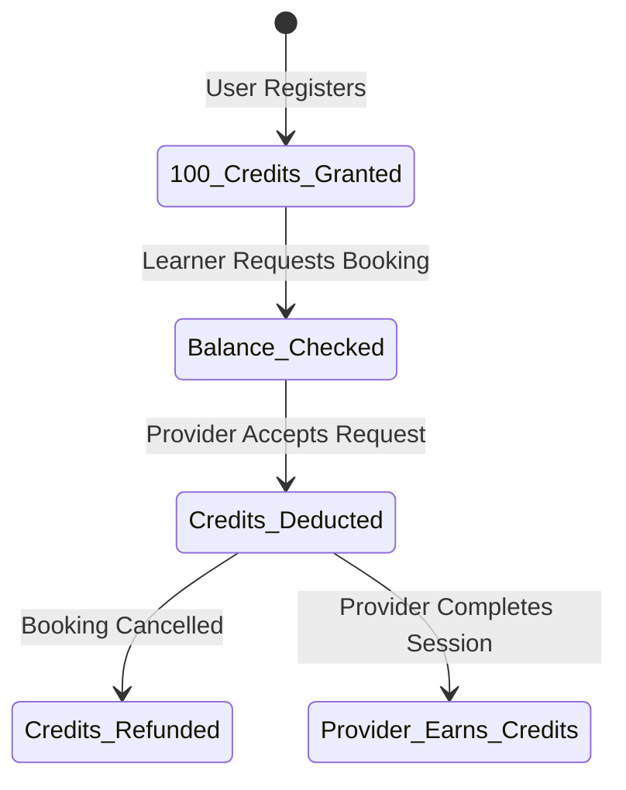

# Skill Exchange Platform — Object-Oriented Analysis & Design (OOAD) Specification

## 1. Project Overview
**Skill Exchange Platform** is a web-based educational peer-to-peer ecosystem built upon a **credits-only exchange model**. Users earn skill credits by teaching peer learners and spend credits to book 1-on-1 sessions with expert providers.

### Strict Business Rule: Non-Monetary Credit Economy
* **Zero currency:** Absolutely no fiat currency amounts, rupee symbols, credit card gateways, or monetary payments.
* **Strict balance enforcement:** Users must possess sufficient skill credits to confirm session bookings.
* **Immutable ledger:** All credit grants, redemptions, teaching rewards, and refunds are recorded in an auditable transaction ledger.
* **Dual roles:** Every learner can seamlessly transition into a provider and earn credits by teaching.

---

## 2. Actors & Use Cases

### 2.1 Skill Seeker (Learner)
* Register account and immediately claim **100 welcome skill credits**.
* Search and filter skill offerings by category, proficiency level, provider rating, and credit cost.
* View provider credentials, bios, verification status, and student reviews.
* Book available calendar slots and request custom sessions.
* Join confirmed sessions via secure room links.
* Cancel bookings under the platform cancellation policy with automatic credit restoration.
* Submit 1-to-5 star ratings and reviews upon session completion.

### 2.2 Skill Provider (Instructor)
* Create and manage skill listings (proficiency, description, duration, and credit cost between 5 and 200 credits).
* Define calendar availability slots.
* Accept or decline student booking requests.
* Deliver sessions and mark them as completed.
* Automatically earn eligible teaching credits upon completion.
* Review student ratings and track lifetime credits earned.

### 2.3 Platform Administrator
* Oversee system statistics: total users, active listings, bookings, and credits in circulation.
* Manage user accounts (search, role filtering, account suspension/reactivation).
* Moderate provider verification requests.
* Inspect the immutable credit transaction audit ledger.
* Execute auditable credit adjustments with mandatory reason logging.
* Analyze visual reports and booking velocity charts.

---

## 3. System Architecture & Modules

```
                    +---------------------------+
                    |   React 18 + TypeScript   |
                    |   (Vite, Tailwind CSS)    |
                    +-------------+-------------+
                                  |
                                  | REST API (JSON / Bearer JWT)
                                  v
                    +-------------+-------------+
                    |    Node.js + Express      |
                    |  (TypeScript Middleware)  |
                    +-------------+-------------+
                                  |
          +-----------------------+-----------------------+
          |                       |                       |
          v                       v                       v
    +-----------+           +-----------+           +-----------+
    |   Auth    |           |  Booking  |           |  Credit   |
    |  Service  |           |  Service  |           |  Engine   |
    +-----------+           +-----------+           +-----------+
          |                       |                       |
          +-----------------------+-----------------------+
                                  |
                                  v
                    +-------------+-------------+
                    |   MongoDB Document Store  |
                    | (Mongoose ODM / In-Memory)|
                    +---------------------------+
```

### Module Breakdown
1. **User & Auth Module:** Handles registration, password hashing (bcrypt), JWT issuance, and active role switching (`learner` / `provider` / `admin`).
2. **Skill Listing Module:** Full CRUD operations for listings, text search indexing, category relationships, and credit cost boundaries (5–200 credits).
3. **Availability & Scheduling Module:** Time-slot management with conflict detection preventing overlapping bookings.
4. **Session Booking Module:** State machine coordinating booking lifecycle (`pending` -> `confirmed` -> `completed` / `cancelled` / `rejected`).
5. **Credit Management Module (`CreditEngine`):** Core non-monetary ledger maintaining balances, preventing negative balances, ensuring single deductions, handling refunds, and preventing duplicate rewards.
6. **Review & Rating Module:** Enforces 1 review per completed session, calculates real-time weighted provider and listing ratings.
7. **Administration & Analytics Module:** Aggregates database metrics, renders date-filtered charts via Recharts, and provides auditable administrative overrides.

---

## 4. Database Schema Design (Mongoose Models)

| Model | Primary Fields | Key Constraints & Indexes |
|---|---|---|
| **User** | `name`, `email`, `password`, `roles`, `currentRole`, `creditBalance`, `creditsEarned`, `creditsSpent`, `providerProfile` | `email` (unique, indexed), `creditBalance` >= 0 |
| **SkillCategory** | `name`, `slug`, `description`, `icon`, `isActive` | `slug` (unique, indexed) |
| **SkillListing** | `provider`, `title`, `category`, `creditCost`, `durationMinutes`, `proficiencyLevel`, `rating`, `reviewCount` | `creditCost` [5, 200], compound index `(category, creditCost)` |
| **AvailabilitySlot** | `provider`, `date`, `startTime`, `endTime`, `isBooked`, `bookingId` | Compound unique index `(provider, date, startTime)` |
| **Booking** | `bookingReference`, `learner`, `provider`, `skillListing`, `date`, `startTime`, `creditCost`, `status`, `creditDeducted`, `creditRewarded` | `bookingReference` (unique, indexed), status enum |
| **CreditTransaction** | `transactionId`, `user`, `type`, `amount`, `balanceAfter`, `relatedBooking`, `description` | `transactionId` (unique), indexed `(user, createdAt)` |
| **Review** | `booking`, `skillListing`, `reviewer`, `provider`, `rating`, `comment` | Unique index on `booking` (prevents duplicate reviews) |
| **Notification** | `user`, `title`, `message`, `type`, `link`, `isRead` | Indexed on `(user, isRead)` |

---

## 5. Credit Economy Business Rules



1. **Welcome Bonus:** Every new user receives exactly 100 skill credits upon registration.
2. **Atomic Verification:** Before booking creation, the server validates `user.creditBalance >= listing.creditCost`.
3. **Single Deduction:** Credits are deducted atomically once when the provider confirms the booking (`creditDeducted: true`). Duplicate requests are rejected.
4. **Refund Policy:** If a booking is cancelled before session completion, `CreditEngine.refundCreditsForBooking()` restores credits and writes a new `session_refund` ledger record.
5. **Teaching Reward:** When a session is marked completed, the provider receives 100% of the session credit cost (`creditRewarded: true`). Duplicate calls are strictly rejected.

---

## 6. UML Diagram Inventory (`docs/uml/`)

All diagrams are written in valid PlantUML format and can be viewed or exported:
1. `use_case_diagram.puml` — Use Case Diagram covering Learner, Provider, and Admin actors.
2. `class_diagram.puml` — Class Diagram illustrating models, attributes, methods, and relationships.
3. `sequence_diagram.puml` — Sequence Diagram tracking the booking, acceptance, and completion lifecycle.
4. `activity_diagram.puml` — Activity Diagram detailing the end-to-end user workflow.
5. `state_diagram.puml` — State Diagram for the booking lifecycle.
6. `component_diagram.puml` — Component Diagram of client, server, and database modules.
7. `deployment_diagram.puml` — Deployment Diagram showing client browser, Node server, and MongoDB.

---

## 7. Functional Test Suite Summary
The system includes automated tests in `server/src/tests/businessRules.test.ts`:
* **Test 1:** Registration with initial 100 skill credits grant.
* **Test 2:** Rejection of booking requests when learner has insufficient credit balance.
* **Test 3:** Exact-once credit deduction upon acceptance & duplicate deduction prevention.
* **Test 4:** Credit restoration upon cancellation with an auditable refund transaction.
* **Test 5:** Awarding teaching credits upon completion & duplicate reward prevention.
* **Test 6:** Review validation (only completed sessions) and duplicate review prevention.
* **Test 7:** Overlapping booking conflict prevention.